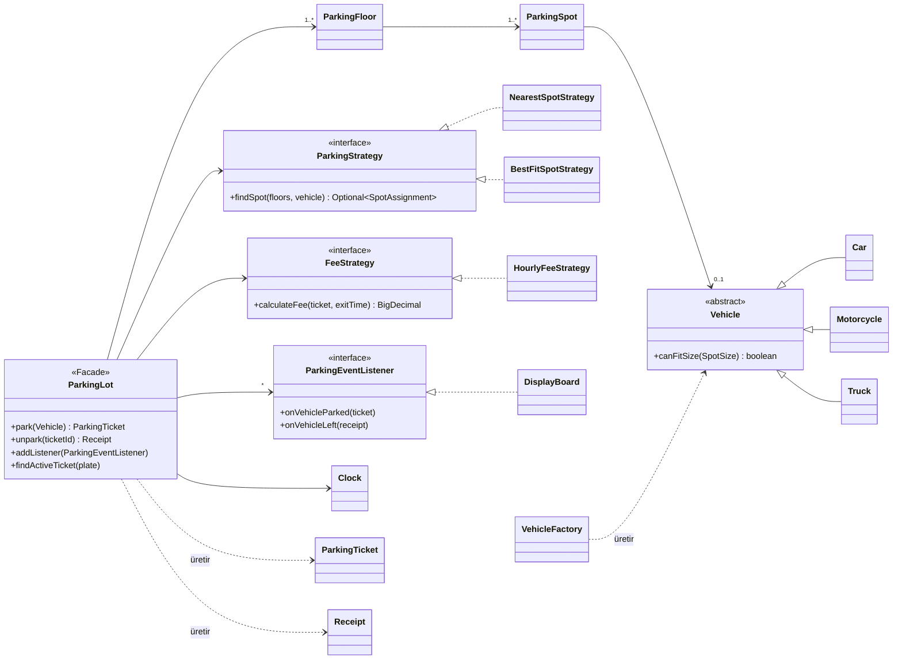

# 🅿️ Parking Lot LLD — Çok Katlı Otopark Sistemi

Java 21 ile yazılmış, **Low-Level Design (LLD)** mülakatlarındaki klasik "otopark tasarla" problemine
thread-safe, test edilebilir ve genişletilebilir bir çözüm.

Projenin amacı sadece çalışan bir otopark yazmak değil; **her tasarım kararını gerekçesiyle**,
alternatifleri ve mülakatta sorulabilecek tuzaklarıyla birlikte ortaya koymak.

---

## ✨ Özellikler

- **Çok katlı otopark**: Her katta farklı boyutlarda (`SMALL`, `MEDIUM`, `LARGE`) park yerleri
- **Araç türleri**: Motosiklet, otomobil, elektrikli otomobil, TIR
- **Akıllı yer seçimi**: Araca sığan en küçük yer; elektrikli araçlar şarjlı yere yönlendirilir
- **Ücretlendirme**: Araç türüne göre saatlik tarife, başlayan saat tam sayılır, ücretsiz süre desteği
- **Thread-safe**: Aynı anda gelen araçlar aynı yere park edilemez, aynı bilet iki kez kullanılamaz
- **Canlı doluluk panosu**: Kat ve boyut bazında boş yer sayısı, olaylarla anlık güncellenir
- **115 birim + eşzamanlılık testi** (JUnit 5)

---

## 🏗️ Mimari



### Paket yapısı

```
com.emirozgen.parking
├── Main.java                  # Composition root + demo
├── model/                     # Domain nesneleri
│   ├── Vehicle, Car, Motorcycle, Truck, VehicleType
│   ├── ParkingSpot, SpotSize, ParkingFloor
│   └── ParkingTicket, Receipt
├── factory/                   # VehicleFactory
├── strategy/
│   ├── spot/                  # ParkingStrategy, NearestSpotStrategy, BestFitSpotStrategy
│   └── fee/                   # FeeStrategy, HourlyFeeStrategy
├── observer/                  # ParkingEventListener, DisplayBoard
├── service/                   # ParkingLot (Facade)
└── exception/                 # Domain exception'ları
```

---

## 🧩 Kullanılan Tasarım Desenleri

| Desen | Nerede | Neden |
|---|---|---|
| **Factory** | `VehicleFactory` | Araç oluşturma mantığı tek yerde; Java 14+ `switch` expression ile tüm türler derleyici kontrolünde |
| **Strategy** | `ParkingStrategy`, `FeeStrategy` | Yer seçimi ve ücret politikası, `ParkingLot`'a dokunmadan değiştirilebilir (OCP) |
| **Facade** | `ParkingLot` | İstemci sadece `park` / `unpark` görür; kat, yer, bilet ve strateji detayları gizli |
| **Observer** | `ParkingEventListener`, `DisplayBoard` | Pano, SMS, analitik gibi yan işler park mantığından bağımsız eklenir |
| **Immutable Object** | `ParkingTicket`, `Receipt` | Thread'ler arası güvenli paylaşım, değiştirilemez fiş (fraud koruması) |
| **Dependency Injection** | Constructor injection + `Main` | Singleton yok; her bağımlılık (strateji, `Clock`) dışarıdan verilir ve testte değiştirilebilir |

**SOLID özetle:**
- **SRP**: Yer seçimi, ücret, park koordinasyonu ve pano ayrı sınıflarda.
- **OCP**: Yeni kural = yeni strateji veya dinleyici sınıfı.
- **LSP**: `Vehicle.canFitSize` ile her araç kendi sığma kuralını tanımlar.
- **ISP**: Küçük arayüzler; dinleyiciler sadece ilgilendikleri olayı uygular.
- **DIP**: `ParkingLot` somut sınıflara değil arayüzlere ve `java.time.Clock`'a bağlı.

---

## 🔒 Eşzamanlılık (Concurrency) Tasarımı

Birden fazla giriş kapısından aynı anda araç gelebileceği varsayılarak tasarlandı.

| Problem | Çözüm |
|---|---|
| İki araç aynı yeri kapmaya çalışıyor | Kilitsiz aday arama + `ParkingSpot.tryPark()` ile **atomik claim**; kaybeden yeniden arar (optimistic retry). Global kilit yok. |
| Aynı plaka iki kapıdan aynı anda giriyor | `ConcurrentHashMap.putIfAbsent`; kaybeden kaptığı yeri geri bırakır (compensating action) |
| Aynı bilet iki kez okutuluyor | `ConcurrentHashMap.remove(key, value)` yalnızca bir thread için başarılı olur |
| Ücret hesabı hata veriyor (ör. saat geri kaydı) | Önce doğrula, sonra değiştir: hata olursa bilet geçerli, yer dolu kalır |
| Pano eşzamanlı olaylarda bozuluyor | `AtomicInteger` ile +1/-1 delta güncelleme; değişmeli (commutative) işlemler sıradan bağımsız |
| Dinleyici listesi okunurken değişiyor | `CopyOnWriteArrayList` |

Eşzamanlılık testleri `CountDownLatch` ile tüm thread'leri aynı anda başlatır ve `@RepeatedTest` ile
tekrarlanır. Pano testinin gerçekten race yakaladığı, sayaç bilerek atomik olmayan hale getirilerek
(mutation testing) doğrulandı.

---

## ⏱️ Test Edilebilirlik

- **Zaman enjekte edilir**: `ParkingLot` bir `java.time.Clock` alır. Testlerde `MutableClock` ile
  "90 dakika sonra" senaryosu `Thread.sleep` olmadan milisaniyede çalışır.
- **Para `BigDecimal`**: `double` yuvarlama hataları yok.
- **Zaman `Instant`**: Saat dilimi ve yaz saati geçişlerinden bağımsız süre hesabı.

---

## 🚀 Çalıştırma

### Gereksinimler
- Java 21+
- Maven 3.9+ (veya IntelliJ IDEA'nın gömülü Maven'ı)

### Demo
```bash
mvn compile
java -cp target/classes com.emirozgen.parking.Main
```

veya IntelliJ IDEA'da `Main.java` → ▶ Run.

### Testler
```bash
mvn test
```

### Örnek çıktı
```
=== BOŞ YER PANOSU ===
Kat 0:  SMALL=1  MEDIUM=2  LARGE=1
Kat 1:  MEDIUM=1  LARGE=1

Giriş: ParkingTicket[..., MOTORCYCLE[34MOT01], kat=0, F0-S1, ...]
Giriş: ParkingTicket[..., ELECTRIC_CAR[34EV02], kat=0, F0-M1, ...]
Giriş: ParkingTicket[..., TRUCK[34TIR03], kat=0, F0-L1, ...]

=== BOŞ YER PANOSU ===
Kat 0:  SMALL=DOLU  MEDIUM=1  LARGE=DOLU
Kat 1:  MEDIUM=1  LARGE=1

Reddedildi: TRUCK[34TIR05] için uygun boş yer yok!

Çıkış: TRUCK[34TIR03], ücret=100 TL
```

---

## 💻 Kullanım Örneği

```java
ParkingLot lot = new ParkingLot(
        floors,
        new BestFitSpotStrategy(),
        new HourlyFeeStrategy(hourlyRates, Duration.ofMinutes(15)),
        Clock.systemUTC());

lot.addListener(new DisplayBoard(floors));

ParkingTicket ticket = lot.park(VehicleFactory.create(VehicleType.CAR, "34 ABC 123"));
// ...
Receipt receipt = lot.unpark(ticket.getTicketId());
System.out.println(receipt.fee() + " TL, süre: " + receipt.parkedDuration());
```

---

## 🗺️ Yol Haritası

- [x] Araç hiyerarşisi ve Factory
- [x] Thread-safe park yeri ve kat modeli
- [x] Immutable bilet (`ParkingTicket`)
- [x] Strategy: yer seçimi ve ücret hesaplama
- [x] Facade: `ParkingLot`, atomik `tryPark`, `Clock` enjeksiyonu
- [x] Observer: doluluk panosu
- [ ] State Pattern: ödeme akışı (aktif → ödeme bekliyor → ödendi → çıktı)
- [ ] `IdGenerator` enjeksiyonu (kısa, okunabilir bilet numaraları)
- [ ] Giriş / çıkış kapıları (`EntranceGate`, `ExitGate`)
- [ ] Decorator ile ücret kuralları (günlük tavan, hafta sonu indirimi, kayıp bilet)

---

## 📄 Lisans

[MIT](LICENSE) © 2026 emir-utku-ozgen
